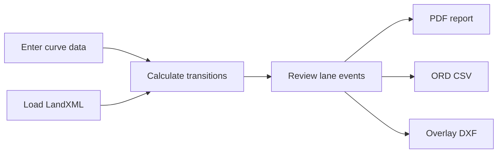

<p align="center">
  
</p>

<p align="center">
  <strong>Browser-based roadway superelevation calculations, design review, and CAD-ready exports.</strong>
</p>

<p align="center">
  <a href="https://github.com/colewinstead/VeriCivil/actions/workflows/tests.yml"></a>
</p>

<p align="center">
  <a href="https://vericivil.com"><strong>Open the live VeriCivil calculator</strong></a>
  &nbsp;&middot;&nbsp;
  <a href="#quick-start">Run from source</a>
  &nbsp;&middot;&nbsp;
  <a href="#engineering-notes">Engineering notes</a>
</p>

---

## What it does

Superelevation Calculator turns roadway curve inputs and LandXML alignments into review-ready calculations and deliverables. It is designed around practical OpenRoads Designer and MicroStation handoff workflows.

| Calculate | Review | Export |
|:--|:--|:--|
| Versioned MDOT and TDOT criteria profiles | Lane-by-lane slopes and stations | PDF calculation reports |
| Normal crown and full super cases | Project, route, alignment, and curve metadata | ORD-compatible CSV |
| Station equations | LandXML geometry validation | Real-coordinate overlay DXF |
| East/West coordinate transforms | Actionable export warnings | Reusable project JSON |

## Typical workflow



1. Enter curve information manually or load an alignment from LandXML.
2. Review calculated transition stations and signed lane slopes.
3. Save the project for later editing.
4. Export a PDF report, ORD CSV, or CAD overlay DXF.
5. Verify the result in OpenRoads Designer or MicroStation before production use.

## Live app

Use the [live VeriCivil browser calculator](https://vericivil.com), the current public version of VeriCivil.

> [!IMPORTANT]
> This is an engineering aid. Always validate criteria, stationing, coordinate systems, lane naming, and exported geometry against the governing standards and the project design file.

## Quick start

Open [vericivil.com](https://vericivil.com) to use the calculator in your browser. No local Python installation is required to use the live app.

To run or build from source, use Python 3.11+ and a standalone Node.js installation, version 22.13 or newer. Python stages the shared engine files; the browser and Electron app use Pyodide for calculations. Installing `requirements-lock.txt` is only needed for native Python calculations and tests.

Clone the repository once if you do not already have it, then enter its root directory:

```bash
git clone https://github.com/colewinstead/VeriCivil.git
cd VeriCivil
```

All commands below run from the **repository root**, the folder containing this README and the `web` and `desktop` folders. If your terminal is already there, skip cloning and `cd VeriCivil`.

### Check the tools

```sh
node --version
node -p "process.execPath"
python3 --version
```

On Windows, use `python --version` instead. The Python executable must be on PATH; a shell alias alone is not sufficient for npm. On this Apple Silicon Mac, the configured default is standalone Homebrew Node 22 at `/opt/homebrew/opt/node@22/bin/node`. Normal `npm` commands use it without a PATH override. Node should not resolve inside `ChatGPT.app`; see [Troubleshooting](#troubleshooting) if it does.

### Install dependencies

Run once after cloning, or again when `web/package-lock.json` changes:

```sh
npm --prefix web ci --ignore-scripts
```

### Run the browser calculator

```sh
npm --prefix web run dev
```

Keep that terminal running. Open [http://localhost:3000/calculators/superelevation](http://localhost:3000/calculators/superelevation); if port 3000 is busy, use the port printed by the server. Press **Ctrl+C** in the terminal to stop it. To choose another port explicitly:

```sh
npm --prefix web run dev -- --port 3001
```

Enter curve inputs or open a saved project, then select **Cross Section** in the results. AASHTO shows recorded lane geometry and fixed pivots; MDOT/TDOT show labeled slope schematics. See the [cross-section controls and roadway support audit](docs/CROSS_SECTION_VIEW.md).

## Electron desktop preview

The desktop app shares the React interface and Python engine with the browser calculator, and bundles its runtime for offline processing. Current desktop tools are free without account login. It supports local recovery, recent projects, native project files, and update controls. Automated downloads remain unsigned previews. Windows installers support user-approved update downloads and restarts; unsigned Mac and portable builds require manual updates. See [desktop lifecycle, installer, and signing instructions](desktop/README.md). The public download page is `/downloads`.

Code signing policy: [vericivil.com/code-signing](https://vericivil.com/code-signing). SignPath approval is pending; prepared signing-review artifacts are not production releases. [Onboarding instructions](docs/signpath-onboarding.md) describe the remaining setup and verification.

Complete the dependency installation above first. The first desktop build needs internet access to download the pinned runtime and export packages; the built desktop app processes calculations offline.

### Run the desktop app from source

Download Electron after `npm ci --ignore-scripts` (repeat this step after running that install command again), then build and launch the desktop app:

```sh
node web/node_modules/electron/install.js
npm --prefix web run desktop:dev
```

`desktop:dev` rebuilds the app and opens its native window. It does not start the browser development server or watch files for changes; close the app and rerun the command after editing source.

### Build without launching

```sh
npm --prefix web run desktop:build
```

The generated application source and bundled offline runtime are in `desktop/app/`. This is the staging folder used by the packaging commands below.

### Package a standalone app

```sh
npm --prefix web run desktop:package
```

This rebuilds and packages the current platform:

| Build computer | Output |
| --- | --- |
| Apple Silicon Mac | `desktop/releases/VeriCivil Desktop Preview-darwin-arm64/VeriCivil Desktop Preview.app` |
| Intel Mac | `desktop/releases/VeriCivil Desktop Preview-darwin-x64/VeriCivil Desktop Preview.app` |
| Windows x64 | `desktop/releases/VeriCivil Desktop Preview-win32-x64/VeriCivil Desktop Preview.exe` |

On this Apple Silicon Mac, open the packaged app with:

```sh
open "desktop/releases/VeriCivil Desktop Preview-darwin-arm64/VeriCivil Desktop Preview.app"
```

### Build an installer or disk image

```sh
npm --prefix web run desktop:installer
```

This rebuilds the app, then creates unsigned installer artifacts for the current platform. On a Mac it creates a DMG and ZIP in `desktop/installers/darwin-arm64/` (Apple Silicon) or `desktop/installers/darwin-x64/` (Intel). On Windows it creates an NSIS `.exe` installer in `desktop/installers/win32-x64/`. Filenames include the application version and `unsigned`. These local commands do not publish a release or deploy the website.

To build a portable Windows x64 ZIP from a Mac:

```sh
npm --prefix web run desktop:package:windows
python3 scripts/package_electron_release.py --platform win32 --arch x64
```

The Windows app folder is in `desktop/releases/`; its ZIP and SHA-256 checksum are in `desktop/release-assets/`. Extract the entire ZIP before launching the EXE on Windows. For signed releases and other archive formats, see the [desktop build and distribution guide](desktop/README.md).

Version-bumped PRs build all three targets automatically and expose downloads under the **Full Release** Actions run. PR runs do not publish a GitHub Release. After merge to `main`, successful release builds attach both Mac DMGs, the Windows portable ZIP, and SHA-256 checksums to the versioned GitHub Release alongside the browser build.

### Build the unbranded desktop edition

The **Superelevation Calculator** edition uses the same UI and calculation engine with a neutral name and SE icon. Select it when building; the installer already contains the selected edition. Complete the dependency and Electron installation steps above first.

On macOS, choose the command for what you want to create:

```sh
# Build and launch from source.
DESKTOP_EDITION=neutral npm --prefix web run desktop:dev
# Build without launching.
DESKTOP_EDITION=neutral npm --prefix web run desktop:build
# Package a standalone app for this Mac's architecture.
DESKTOP_EDITION=neutral npm --prefix web run desktop:package
# Create an unsigned DMG and ZIP for this Mac's architecture.
DESKTOP_EDITION=neutral npm --prefix web run desktop:installer
```

On Windows PowerShell, set the edition for the current terminal, then use the same npm commands:

```powershell
$env:DESKTOP_EDITION = 'neutral'
npm --prefix web run desktop:package
npm --prefix web run desktop:installer
# Archive the packaged app as a portable Windows ZIP with a checksum.
python scripts/package_electron_release.py --platform win32 --arch x64 --edition neutral
# Return subsequent builds to the default VeriCivil edition.
Remove-Item Env:\DESKTOP_EDITION
```

| Output | Location |
| --- | --- |
| Staged app and offline runtime | `desktop/app-neutral/` |
| Standalone Mac app or Windows EXE folder | `desktop/releases/neutral/` |
| Mac DMG/ZIP | `desktop/installers/neutral/darwin-arm64/` or `desktop/installers/neutral/darwin-x64/` |
| Windows installer | `desktop/installers/neutral/win32-x64/` |
| Archived previews and checksums | `desktop/release-assets/` |

To create a neutral portable Windows x64 ZIP from a Mac:

```sh
DESKTOP_EDITION=neutral npm --prefix web run desktop:package:windows
python3 scripts/package_electron_release.py --platform win32 --arch x64 --edition neutral
```

Both editions can be installed together with separate profiles and updater caches. The neutral edition opens existing `.json` and `.vericivil` projects, saves new projects as `.json`, and leaves file associations unchanged. Windows installers check for neutral updates and require approval to download/restart; unsigned Macs and portable builds require manual replacement. Neutral release assets are publicly reachable on GitHub but omitted from the website's download buttons. These local commands do not publish anything. See the [neutral desktop guide](desktop/README.md#neutral-desktop-edition) for archive commands, distribution details, and checks.

## Browser app

The browser app runs the shared Python calculation and export modules locally through Pyodide. Calculation inputs, project data, and LandXML content are processed in the browser tab and are not automatically uploaded. The hosted site also provides server-side sign-in, plan entitlements, billing, and anonymous usage analytics.

Local development defaults to Pro without an account or URL parameter. The calculator's Local test plan selector can switch to Free or Team for testing; explicit `?entitlement=free` overrides remain supported. The hosted website continues to use account entitlements.

### Build the browser app for production

```sh
npm --prefix web run build
```

The output is written to `web/dist`, including browser assets and a Cloudflare Workers-compatible server runtime for the hosted account and billing routes. Use `npm --prefix web run dev` for local testing; the production server bundle uses Cloudflare bindings and cannot be launched with plain Node through `npm --prefix web start` in this configuration. The build stages the authoritative shared Python modules from the repository; do not edit the staged copies. Website publishing remains the separate [Ship main workflow](#browser-and-desktop-releases).

The first browser visit downloads the Python runtime and scientific/export packages. After that initial load, calculations and file exports occur on the user's device. Save and reopen `.superelevation.json` project files locally through the browser interface.

## Export formats

### PDF report

Produces a formatted calculation report using the same calculated curve data shown in the browser interface.

### ORD CSV

Writes Bentley's documented superelevation import columns:

```text
SuperelevationLane,Station,CrossSlope,PivotAbout,PointType,TransitionType,NonLinearCurveLength
```

Station labels account for LandXML station equations and advance through ORD regions such as `R2`, `R3`, and `R4`.

### Overlay DXF

Creates a graphics overlay in real project coordinates from LandXML line and circular-arc geometry. It includes:

- lane-specific leaders and signed slope labels
- PC and PT station callouts
- curve names, direction, and radius
- collision-aware label placement
- MDOT-oriented levels, colors, weights, and text styling
- US survey foot declarations and optional East/West zone transformation

The DXF is a graphics handoff, not a native Bentley civil model.

## LandXML support

| Supported | Detected with warning |
|:--|:--|
| Alignment name and start station | Spiral geometry |
| Linear units | Unsupported or incomplete geometry |
| Line geometry | Ambiguous displayed stations |
| Circular arcs | Out-of-range export stations |
| Station equations | Missing coordinate context |

## Engineering notes

The **Cross Section** analysis tab provides station-by-station pavement rotation review in the browser and Electron workspace. AASHTO sections show recorded lane geometry and fixed pivots; MDOT/TDOT show explicitly labeled slope schematics where physical layouts are unspecified. See the [cross-section guide and roadway support audit](docs/CROSS_SECTION_VIEW.md).

The authoritative application and calculation-engine versions are defined in [`app_info.py`](app_info.py). The engine centralizes each MDOT lane transition as one piecewise-linear profile used by diagrams, lookup, QA, and exports. The outside lane runs from zero cross slope to full super, while the inside lane holds normal crown until the SE-3A `X1 = Lr(NC/e)` breakpoint and then rotates linearly to full super. Explicit reverse-curve pairs remove only the intervening tangent runout and require `Tmin = 0.7Lr(exit) + 0.7Lr(entry)`. Each lane retains the applicable standard `e/Lr` rate, joins continuously at an intersection when needed, or holds normal crown until the incoming transition begins. A valid unequal-rate intersection may occur just before PT or just after PC because both points lie within the recorded runoffs; the unchanged full-super stations bound the coordinated profile. A normal-crown hold records only its real start and end control points. A short or invalid pair blocks coordination without changing the independent curve results. See [`docs/MDOT_TRANSITION_MODEL.md`](docs/MDOT_TRANSITION_MODEL.md). These identifiers are defined once in `app_info.py` and are recorded in new project files and PDF reports.

> [!CAUTION]
> Calculations record the selected criteria profile and source revision. The default `mdot-rdsd-2026-04-22` profile preserves the existing MDOT behavior. The `tdot-rd11-2026-04-30` profile uses TDOT RD11-LR-1's desirable 4% urban table, RD11-LR-2's desirable 8% rural table, and RD11-SE-1 transition equations for undivided-roadway lane events. It also records the RD11 typical-section catalog as supporting design criteria; width, grade, sight-distance fields, and divided-roadway lane geometry are not automatically modeled. The licensed professional responsible for the project must independently verify criteria, applicability, inputs, results, and deliverables. See [`docs/PAID_PILOT_READINESS.md`](docs/PAID_PILOT_READINESS.md), [`docs/COMMERCIAL_READINESS.md`](docs/COMMERCIAL_READINESS.md), and [`docs/PILOT_OPERATIONS.md`](docs/PILOT_OPERATIONS.md).

The `aashto-green-book-2018-2019-10` profile loads reviewed Tables 3-8 through 3-12 and corrected Table 3-16a from `aashto_tables.py`; no Excel import is needed for automatic calculations. It supports NC/RC thresholds, equal-width fixed-pivot sections, and established clothoid transitions. Green Book §3.3.5 selects the first qualifying row in increasing rate order using a tabulated radius at or below the actual radius; interpolation is unnecessary. Results record the selected row, source hashes, and embedded-data provenance. Continuous Method 5 equations and new alignment construction remain excluded. Circular runoff placement is an explicit project input; spiral runout may be on tangent or in spiral. Short spirals block calculation, and longer zero-crown holds require acknowledgement and drainage review. **Public redistribution rights remain unresolved. The repository owner authorized including the embedded data in a public draft PR; this does not establish publisher permission. Merge, release, and deployment remain unauthorized.** See [AASHTO scope, sources, and acceptance limits](docs/AASHTO_2018.md) before use.

AASHTO ramp inputs use lane count, one shared lane width, and initial slope magnitude plus **Drains left / Drains right** (looking ahead along increasing station). Multi-lane ramps may be single-slope or crowned and remain one-way. New ramp inputs offer left/right pavement-edge rotation; saved centerline pivots are retained explicitly. Automatic NC/RC selection retains a permitted initial slope or calculates adverse-slope removal. A retained slope reports zero superelevation transition demand without claiming a zero horizontal-design spiral minimum. Unequal widths and ramp-terminal/mainline warping remain unsupported.

**Divided roadway — Case II** calculates both directions together on a common baseline. Each carriageway has separate design speed/radius, 1–7 equal-width lanes, uniform initial slope, placement, and an explicit inside travel-lane pivot offset. Both pivots remain level relative to the common profile. Browser/Electron inspection, saved projects, PDF and DXF identify both sides; Case II ORD CSV and legacy Tkinter editing/export are blocked. See [Case II scope and validation](docs/AASHTO_2018.md#case-ii-divided-roadway-engine-160).

LandXML reverse-curve notices appear only when opposing curves have overlapping calculated runoff/runout. Before both curves are added, the shared Python engine can provide a labelled spacing preview from the current design inputs; incomplete or unsupported inputs leave the spacing unchecked. Corridor QA and PDF record the overlap interval, available spacing, current independent transition demand, and a recommendation for sufficient tangent or combined spiral/tangent space. Constant-slope holds do not add transition demand. This demand is not a universal agency minimum. Actual eligible MDOT pairs may be linked explicitly; AASHTO/TDOT overlaps require engineering review. Detection does not modify horizontal geometry or shorten transitions.

For an AASHTO manual check without LandXML, select **Manual calculation → Required spiral lengths**. Enter speed and radius and confirm maximum superelevation and the roadway section. PC/PT are optional references; TS/ST are not needed. Results show minimum spiral length for runoff only (runout on tangent) and runoff plus runout (both in spiral), with governing sources. This advice does not construct a horizontal alignment or produce exportable curve stations. Use **Transition stations** with established geometry for lane events and curve exports.

<details>
<summary><strong>ORD import checklist</strong></summary>

Before production use, verify that:

- the target superelevation section and lanes already exist
- lane names match between the application and ORD
- station formatting matches the design file
- station equations resolve to the intended alignment region
- transition type, pivot settings, and nonlinear lengths match project criteria

</details>

<details>
<summary><strong>Lane slope sign convention</strong></summary>

- Normal crown: both lanes negative
- Right-hand curve: left lane positive, right lane negative through full super
- Left-hand curve: left lane negative, right lane positive through full super
- Positive display values always include an explicit `+`

</details>

<details>
<summary><strong>DXF and MicroStation checks</strong></summary>

Always verify reference units, working units, origin, coincident placement, rotation, stationing assumptions, text scale, and readability in ORD or MicroStation.

LandXML points are interpreted as Northing/Easting and written to CAD as X=Easting and Y=Northing. Coordinate transformation requires the correct MDOT MS83/2011 East or West zone selection.

</details>

## Project structure

| File | Purpose |
|:--|:--|
| [`super_service.py`](super_service.py) | Platform-neutral calculation, project, and export service |
| [`Super.py`](Super.py) | Core superelevation calculation path |
| [`super_landxml.py`](super_landxml.py) | LandXML parsing and station geometry |
| [`super_exports.py`](super_exports.py) | Shared lane-event and export logic |
| [`super_dxf.py`](super_dxf.py) | Overlay DXF generation |
| [`super_pdf.py`](super_pdf.py) | PDF calculation reports |
| [`super_project.py`](super_project.py) | Project save/load support |
| [`app_info.py`](app_info.py) | Authoritative application and engine versions |
| [`criteria_info.py`](criteria_info.py) | Criteria/source traceability metadata |
| [`tdot_criteria.py`](tdot_criteria.py) | Versioned TDOT RD11 radius, gradient, and lane-factor tables |
| [`web`](web) | Browser-only React interface and Pyodide worker |

## Project-file compatibility

Projects use JSON schema version 5. The application migrates schema v1 through v4 files in memory and preserves older calculation provenance as `legacy-unversioned` when needed. It refuses project files created by a newer schema rather than silently discarding unknown data.

Schema v4 introduced embedded LandXML text, original filename, and SHA-256 integrity. Schema v5 adds explicit, adjacent, disjoint `reverse_curve_pairs`. Opening and resaving an older project upgrades its container to schema v5; it preserves recorded results and provenance and does not silently recalculate them with the current engine.

## Troubleshooting

For local startup, `ENOENT ... package.json` or an `npm ci` missing-lockfile error usually means npm is targeting the wrong directory. From the repository root, use `npm --prefix web ci --ignore-scripts` and `npm --prefix web run dev` as shown above.

If a macOS native-binding error includes “different Team IDs,” check `node -p "process.execPath"`. A Node executable embedded in another signed application can reject the bundler's native module even when the dependency is installed. Configure a standalone Node installation as the terminal's default, then open a new terminal tab and rerun the normal command. On the development Mac, the user-local `~/.local/bin/node` link and Zsh startup files now select the installed Homebrew Node 22 instead of ChatGPT's private runtime. Reinstalling npm dependencies does not correct a mismatched Node executable.

If Electron reports that it failed to install correctly after `npm ci --ignore-scripts`, run `node web/node_modules/electron/install.js`, then retry `npm --prefix web run desktop:dev`. If a desktop launch behaves like a Node process instead of opening a window, check that `ELECTRON_RUN_AS_NODE` is not set in that terminal; remove that environment setting before launching Electron.

When reporting a problem, include the browser and operating system, application and engine versions, selected criteria profile, expected behavior, and a minimal reproduction using non-sensitive data. Browser developer-console messages can help diagnose loading and export errors. Review any console output before sharing it.

## Browser and desktop releases

Documentation-only changes (`.md`, `.rst`, and license files) pass the version check without a version bump and do not create a release or desktop packages. Changes to application code, calculation data, tests, dependencies, builds, or workflows must increase `APP_VERSION` in `app_info.py` beyond the latest GitHub release, including when combined with documentation edits. A valid version-bumped PR builds unsigned Electron previews on native Apple Silicon, Intel Mac, and Windows runners. After those changes merge and all release jobs pass, GitHub publishes a release tagged `vMAJOR.MINOR.PATCH` with the browser build archive and desktop preview downloads.

Before a browser release, run the Python tests, TypeScript check, lint, production build tests, and Pyodide parity checks. GitHub publishes the browser archive after the release workflow succeeds. Publishing that release to the existing live Site is a separate `Ship main` step; reuse the Site identified by `web/.openai/hosting.json`.

## Tests

```powershell
python -m pip install -r .\requirements-lock.txt
python -m unittest -v
```

The browser parity suite builds the production app, renders its shell, runs the shared Python engine in Pyodide, checks an approved numeric vector, and generates CSV, PDF, and DXF outputs:

```bash
npm --prefix web ci --ignore-scripts
npm --prefix web exec -- tsc --noEmit -p web/tsconfig.json
npm --prefix web run lint
npm --prefix web test
```

The test suite covers calculation sharing, station formatting, lane signs, LandXML parsing, coordinate transforms, project persistence, ORD CSV mapping, and DXF generation.

It also covers version/criteria metadata, project schema migration/refusal, PDF traceability, release-change classification, and a synthetic end-to-end LandXML/CSV/PDF/DXF/project workflow.

## Contributing

Bug reports and focused pull requests are welcome. When reporting an export problem, include the expected stationing/sign behavior and a minimal, non-sensitive reproduction case.

Use one short-lived branch per issue or feature:

1. Open or reuse a GitHub issue describing the problem and acceptance criteria.
2. In the issue's **Development** section, choose **Create a branch**, use `main` as the source, and include the issue number in the name, such as `fix/123-export-error` or `feat/123-new-calculator`.
3. Fetch in VS Code and check out that branch. Make the scoped change, run the applicable checks, commit, and push. Code/configuration changes need a version bump; documentation-only changes do not.
4. Open a PR from the issue branch into `main`. Include `Closes #123` when the issue is fully resolved, or `Related to #123` for partial work.
5. Wait for required checks and merge using **Squash and merge**, producing one commit per PR. Only squash merges are enabled in repository settings and the `main` ruleset. If GitHub requires a branch update, merge the latest `main` into the issue branch and let checks rerun. GitHub automatically closes fully resolved issues and deletes the merged remote branch.
6. Switch to `main`, pull the latest changes, and start the next issue from there. Delete the old local issue branch only after checking that its work is merged and the working tree is clean. The former permanent `dev` workflow is retired.

After an application release succeeds, invoke **Ship main** to publish the matching website version. Documentation-only changes do not require a website update.

## License

This project is licensed under the [MIT License](LICENSE). Copyright (c) 2026 Cole Winstead. See `LICENSE` for the full terms. Third-party dependencies retain their own licenses.
